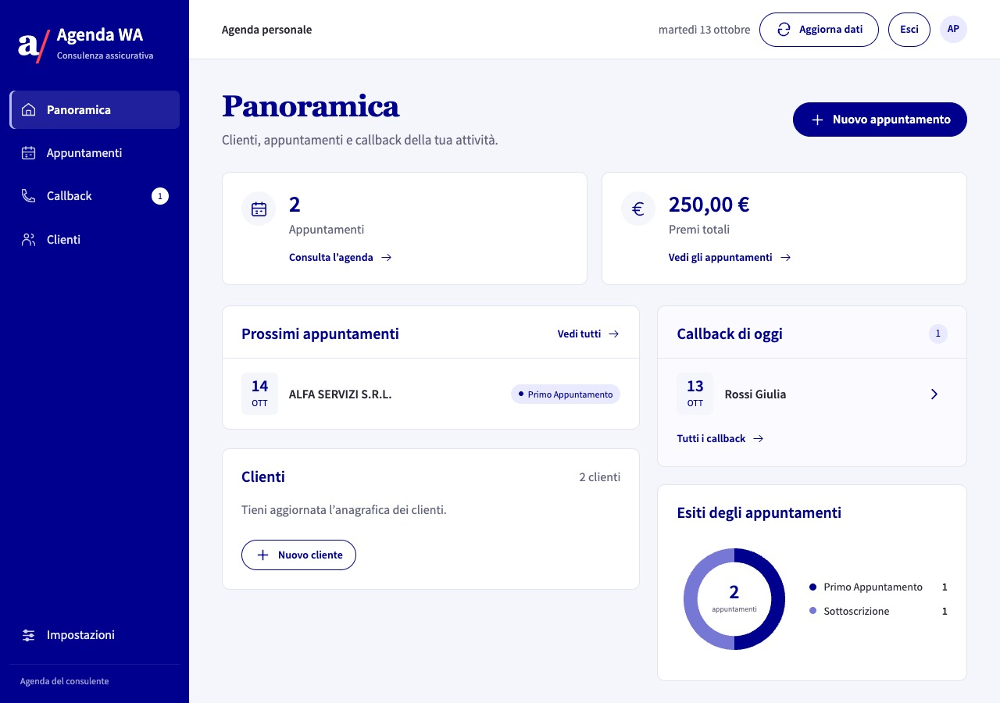
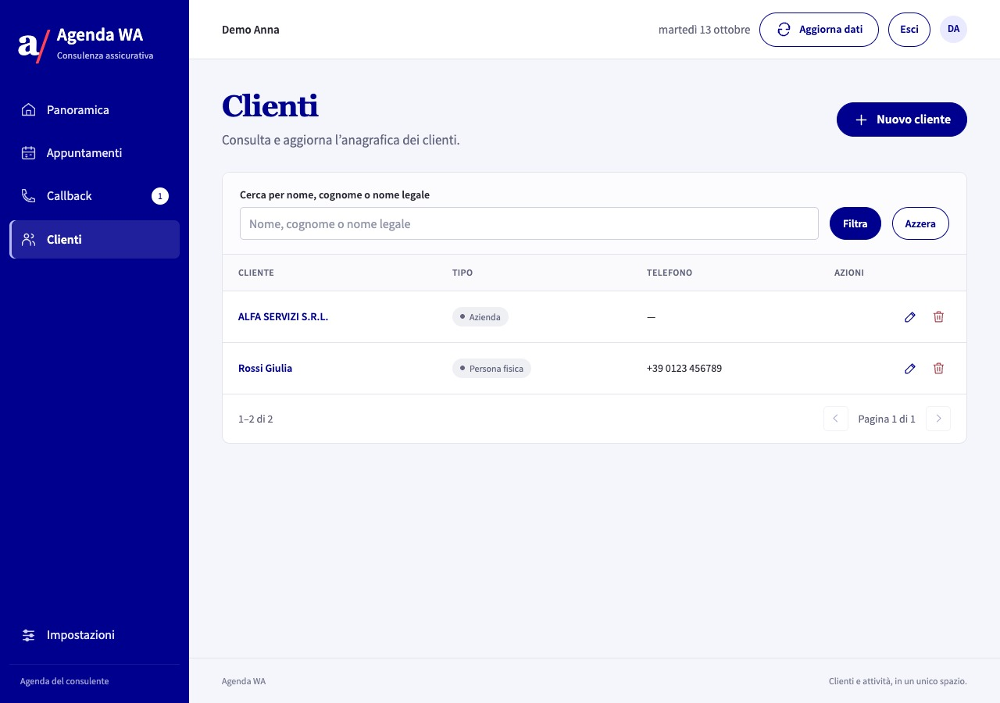
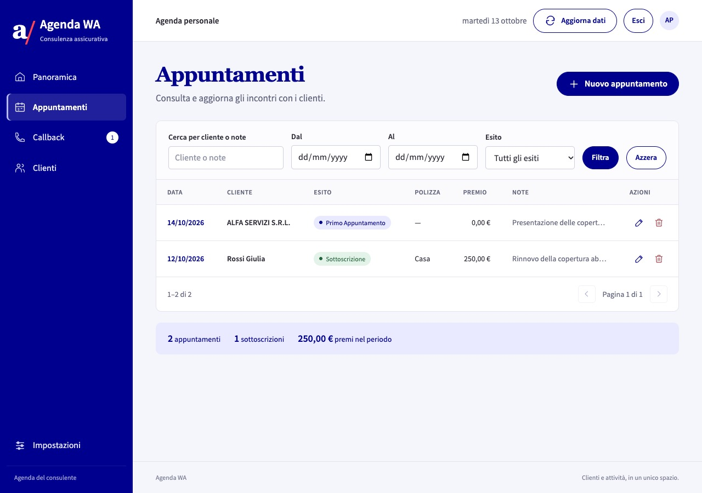
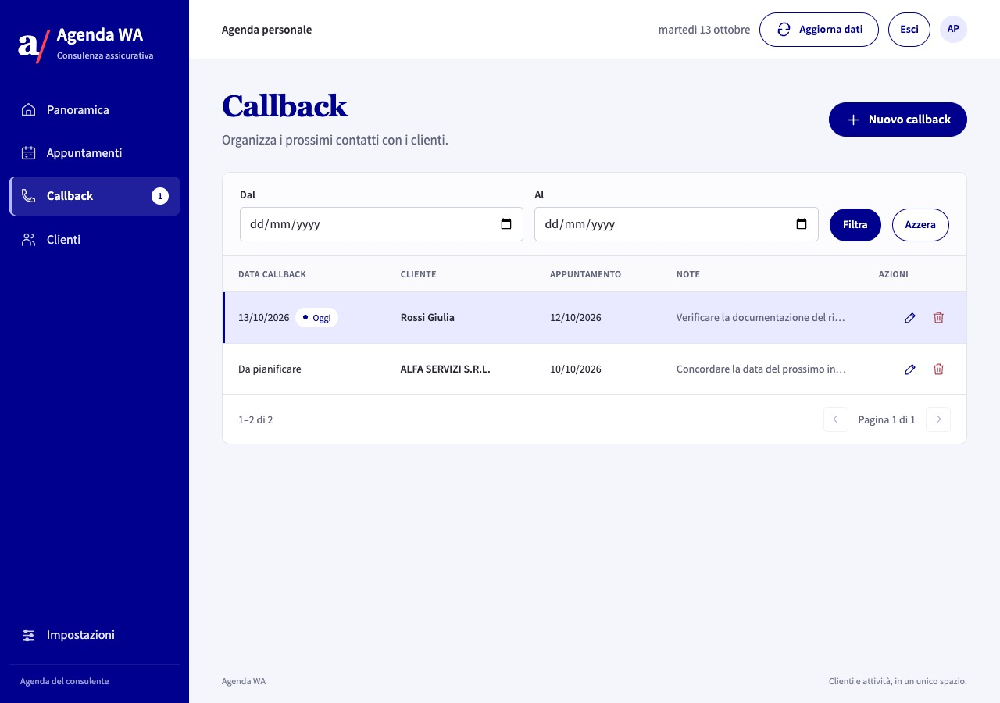

# Agenda WA — locale

Agenda per gestire **clienti, appuntamenti e callback**, con esiti e polizze personalizzabili. Funziona offline, su un solo computer, con interfaccia nel browser e database H2.

## Avvio

Scarica il pacchetto dalla cartella [dist](dist/): **amd64** per Intel/AMD, **arm64** per ARM. Java è incluso. Dopo l’installazione avvia **Agenda WA** dal menu Linux e accedi con la password concordata.

In **Impostazioni** puoi esportare e ripristinare i dati; le copie automatiche vengono salvate sul computer.

## Sviluppo

Richiede Java 21 o superiore. Dalla cartella del progetto:

```sh
./servizio/mvnw -f servizio/pom.xml package
java -jar servizio/target/agenda-wa.jar
```

Apri **http://localhost:8080**. Nel terminale, **Ctrl+C** arresta l’applicazione.

## Schermate

Esempi con dati dimostrativi. Clicca sulle immagini per ingrandirle.

| Panoramica | Clienti |
| :---: | :---: |
| [](docs/web/readme-panoramica.jpg) | [](docs/web/readme-clienti.jpg) |
| **Appuntamenti** | **Callback** |
| [](docs/web/readme-appuntamenti.jpg) | [](docs/web/readme-callback.jpg) |

[Backup e ripristino: screenshot](docs/web/readme-backup.jpg).

Il branch **`locale`** contiene questa versione; **`online`** contiene quella con MongoDB e account personali. Per i dettagli tecnici: [architettura](docs/ARCHITETTURA.md).
