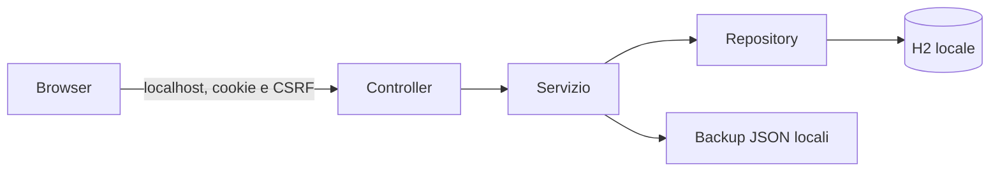

# Architettura dell’edizione locale

Java 21 / Spring Boot 4.0.5 serve API e risorse statiche sul loopback. Il browser usa soltanto risorse incluse nel pacchetto. H2 2.4.240 lavora nello stesso processo, in modalità file: nessun servizio database da installare o esporre.

## Organizzazione

`controllers` inietta le interfacce in `service/interfaces`, valida i DTO per area e restituisce DTO espliciti. Le implementazioni `*ServiceImpl` gestiscono regole e transazioni. `repository` contiene JDBC, DDL, query, mappatura delle righe e I/O dei backup; `mapper` converte le entità senza interrogare il database. `security` gestisce identità locale, password, JWT, CSRF e limiti di accesso.

La sostituzione di MongoDB conserva i contratti applicativi dei clienti, appuntamenti, callback e cataloghi. Le differenze intenzionali sono login con sola password, assenza di registrazione e nuovi endpoint backup. La risorsa resta `/api/callback`, con `creaCallback`, `dataCallback` e `callbackOggi`.

## Persistenza e concorrenza

[SqlSchemaRepository](../servizio/src/main/java/xyz/nardone/agenda_wa/servizio/repository/SqlSchemaRepository.java) inizializza lo schema 1 in Java e rifiuta versioni non supportate. Tabelle: `utenti`, `metadati`, `clienti`, `cataloghi`, `appuntamenti`, `callback`, `operation_lock`, `schema_version`. Le attività hanno chiave esterna composta cliente/proprietario e cancellazione a cascata; i cataloghi hanno unicità per proprietario, tipo e chiave normalizzata. Premi DECIMAL(12,2), date DATE. Non vengono interpretati comandi SQL provenienti dall’utente.

`ownerId` resta una barriera interna: l’unica identità ammessa ai JWT applicativi è `locale`, ricavata da `UserScope`. Tutti i repository applicativi filtrano il proprietario anche per conteggi, riferimenti e cancellazioni. I test introducono una seconda identità per verificare che ID conosciuti e ripristini non accedano ai suoi dati.

[SqlOperationLock](../servizio/src/main/java/xyz/nardone/agenda_wa/servizio/repository/SqlOperationLock.java) acquisisce una riga `FOR UPDATE` nella transazione e serializza tutte le modifiche, esportazioni, copie automatiche e ripristini. Gli aggiornamenti sono UPDATE distinti da INSERT: un salvataggio concorrente non ricrea un record cancellato. Le letture composte usano REPEATABLE_READ per conteggi e pagine coerenti.

Lo storico `{id,data,esito}` è una proiezione SQL degli appuntamenti del cliente, paginata e ordinata per data decrescente. Le generalità copiate negli appuntamenti vengono aggiornate dalla transazione che rinomina il cliente. Nome/cognome sono minuscoli e nome legale maiuscolo; i limiti vengono verificati anche dopo la normalizzazione Unicode.

La ricerca clienti usa frammenti normalizzati. Quella appuntamenti richiede tutte le parole intere tra generalità e note, senza stemming e senza distinzione di maiuscole/accenti. Il testo derivato è un CLOB, per contenere le espansioni Unicode. I callback di oggi precedono gli altri prima della paginazione; fuso Europe/Rome.

## Avvio e accesso

Il launcher nativo incluso dal `.deb` avvia il JAR Spring Boot con Java incluso. [LocalLaunchGuard](../servizio/src/main/java/xyz/nardone/agenda_wa/servizio/config/LocalLaunchGuard.java) usa un lock del sistema operativo per la cartella dati; una seconda invocazione apre soltanto il browser. [BrowserLaunch](../servizio/src/main/java/xyz/nardone/agenda_wa/servizio/config/BrowserLaunch.java) usa l’apertura URL di sistema dopo l’avvio HTTP.

`FixedPassword` verifica l’hash privato PBKDF2-HMAC-SHA256 (sale 16 byte, 600.000 iterazioni, digest 32 byte). La build senza hash valido non parte. Nessuna password, hash o chiave viene registrata nei log o inclusa nel codice pubblico. JWT HS256 durano due ore, cookie HttpOnly/SameSite=Strict e percorso `/api`; le modifiche richiedono CSRF. Logout e ripristino incrementano la versione dei token e revocano le sessioni. Login è limitato dopo dieci tentativi errati per 15 minuti.

`LocalBootstrap` richiama il servizio transazionale di inizializzazione prima dell’avvio HTTP. L’identità locale e il seed privato vengono creati una sola volta; un metadato persistente impedisce il reinserimento dei cataloghi cancellati. Il seed accetta soltanto clienti e polizze, senza attività o credenziali originali.

## Backup

[BackupServiceImpl](../servizio/src/main/java/xyz/nardone/agenda_wa/servizio/service/BackupServiceImpl.java) produce snapshot JSON ordinate, formato `agenda-wa-backup`, versione 1, data UTC e SHA-256 dei dati canonici. Il contenuto include dati di dominio, senza `ownerId`, password o chiavi. SHA-256 rileva corruzione, senza costituire firma o cifratura.

Esportazione: `GET /api/backup`; stato copie: `GET /api/backup/stato`; ripristino multipart: `POST /api/backup/ripristino`. Il caricamento viene letto come stream, validato nei DTO e nei riferimenti, poi ripristinato in una transazione. Prima della sostituzione viene salvata una copia preventiva. Le snapshot sono elaborate in memoria; non c’è una soglia arbitraria di 20 MB.

[BackupFilesRepository](../servizio/src/main/java/xyz/nardone/agenda_wa/servizio/repository/BackupFilesRepository.java) scrive file temporanei, forza i dati su disco e rinomina atomicamente, con permessi 600. La conservazione riguarda soltanto file regolari con i propri prefissi. Copie automatiche ogni 15 minuti, solo se cambia l’impronta; ultime 14 automatiche e 5 preventive. La cartella dati ha permessi 700.

La pulizia dei test riguarda solo cartelle e container isolati. Nessuna cancellazione indiscriminata avviene all’avvio e nessun processo della versione locale accede al MongoDB originale.
