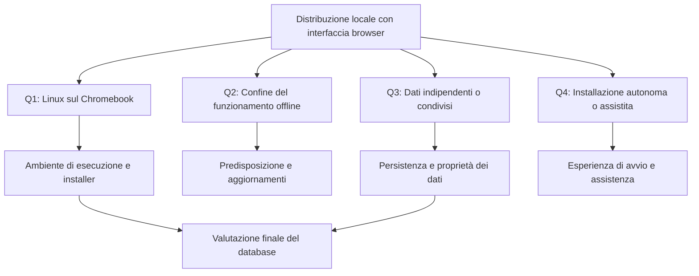

# Distribuzione locale di Agenda WA

Analisi del 13 ottobre 2026, avviata con le skill `grill-with-docs`, `grilling` e `domain-modeling`. Le opzioni e le raccomandazioni riportate qui sono preliminari: nessun cambio di database o architettura è stato approvato o implementato.

## Obiettivo espresso

Distribuire Agenda WA a un destinatario che possa installarla facilmente sul proprio computer e usarla localmente, mantenendo l'interfaccia nel browser. Il primo dispositivo considerato è un Chromebook. È da valutare la sostituzione di MongoDB con un database relazionale incorporato, come H2.

Il significato di «non online» durante prima installazione e aggiornamenti, il grado di autonomia dell'installazione e l'eventuale condivisione dei dati fra dispositivi restano da chiarire.

## Situazione verificata nel repository

- L'app è già locale: un solo processo Java 21 / Spring Boot serve API, HTML, JavaScript, CSS e font. Il browser chiama le API sullo stesso indirizzo; non sono state trovate dipendenze Internet nel funzionamento ordinario. Riferimenti: [POM](../servizio/pom.xml), [client API](../servizio/src/main/resources/static/js/api.js), [architettura](ARCHITETTURA.md).
- Il server ascolta su `127.0.0.1`, porta predefinita 8080. MongoDB usa la porta locale 27018 e il replica set `rs0`. Le transazioni applicative dipendono da questo replica set. Riferimenti: [configurazione](../servizio/src/main/resources/application.properties), [transazioni](../servizio/src/main/java/xyz/nardone/agenda_wa/servizio/config/MongoConfiguration.java).
- L'avvio documentato richiede Java, MongoDB, inizializzazione del replica set e comandi manuali. Il risultato della compilazione è un JAR; non è configurato un installer con runtime incluso. Riferimento: [README](../README.md).
- Le credenziali sono locali. JWT, cookie HttpOnly, CSRF e isolamento tramite `ownerId` sono già implementati e restano requisiti del progetto anche nell'uso offline.
- La chiave JWT ha un percorso predefinito relativo alla directory di avvio. La distribuzione deve prevedere una destinazione stabile per dati e segreti, separata dai binari aggiornabili.
- Non sono state trovate funzioni per l'utilizzatore di backup, ripristino, recupero password o aggiornamento del prodotto. Le copie e le importazioni descritte nel README documentano interventi precedenti sul progetto.

## Vincoli verificati di Chromebook

Google documenta che l'ambiente Linux è disattivato per impostazione predefinita e può non essere disponibile sui dispositivi gestiti da un'organizzazione. La sua prima configurazione scarica componenti; con Linux predisposto, ChromeOS permette di installare pacchetti `.deb` dall'app File e avviare applicazioni dal menu. Fonti: [Google Help](https://support.google.com/chromebook/answer/9145439?hl=en), [configurazione Linux ChromeOS](https://chromeos.dev/en/linux/setup).

ChromeOS inoltra le connessioni a `localhost` verso il container Linux, con restrizioni sulle porte. La raggiungibilità effettiva con il binding del progetto e l'apertura del browser dal lanciatore devono essere provate sul dispositivo supportato. Fonte: [Chromium, inoltro localhost](https://www.chromium.org/chromium-os/developer-library/reference/security/port-forwarding/).

`jpackage` può produrre un installer Linux con runtime Java incluso, evitando un'installazione separata di Java. La costruzione avviene sulla piattaforma destinazione; il container ChromeOS mantiene l'architettura del dispositivo. I pacchetti e le verifiche devono quindi coprire le architetture che si sceglierà di supportare. Fonti: [documentazione jpackage](https://docs.oracle.com/en/java/javase/25/jpackage/packaging-overview.html), [FAQ ChromeOS](https://chromeos.dev/en/linux/linux-on-chromeos-faq).

Conclusione preliminare, da verificare con un prototipo: conservare Spring Boot e il browser è fattibile sui Chromebook compatibili con Linux e autorizzati a usarlo. Il cambio a H2 non elimina questo requisito. Un prodotto che debba funzionare senza Linux richiede di rivalutare l'esecuzione del backend, ad esempio spostando logica e persistenza nel browser.

## Valutazione preliminare del database

H2 in modalità embedded con persistenza su disco lavora nello stesso processo Java e supporta transazioni e vincoli relazionali. Questo elimina la necessità di amministrare un processo MongoDB separato ed è una candidata per una singola installazione locale. La modalità in memoria non soddisfa il requisito di conservare i dati dopo l'arresto. Fonte: [H2, funzionalità](https://h2database.com/html/features.html).

La migrazione del progetto è sostanziale: coinvolge entità e indici MongoDB, repository, pipeline di aggregazione, ricerca testuale e comportamento degli accenti, storico incorporato nei clienti, copie delle generalità e dei cataloghi, transazioni e contatori di revisione. Si possono conservare i contratti HTTP e gran parte dell'interfaccia, ma la compatibilità deve essere verificata. Riferimenti: [architettura corrente](ARCHITETTURA.md), [query](../servizio/src/main/java/xyz/nardone/agenda_wa/servizio/repository/query/Queries.java), [repository dello storico](../servizio/src/main/java/xyz/nardone/agenda_wa/servizio/repository/ClientRepositoryCustomImpl.java).

H2 documenta backup coerenti e procedure di aggiornamento del motore tramite esportazione e importazione. Un semplice cambio di dipendenza Maven non rende il prodotto pronto per la produzione. Fonte: [H2, aggiornamenti e backup](https://h2database.com/html/tutorial.html#upgrade_backup_restore).

## Primo round: decisioni aperte

| Domanda | Decisione richiesta | Raccomandazione preliminare |
| --- | --- | --- |
| Q1 | È accettabile richiedere l'abilitazione iniziale di Linux sui Chromebook supportati? | Sì, con procedura guidata e compatibilità dichiarata. |
| Q2 | Internet può servire per predisposizione iniziale e consegna degli aggiornamenti, oppure anche queste operazioni devono essere completamente offline? | Consentire Internet per la predisposizione; uso quotidiano autonomo offline. |
| Q3 | Ogni computer conserva un'agenda indipendente oppure gli stessi dati devono essere disponibili su più dispositivi? | Agende indipendenti nella prima versione locale. |
| Q4 | Il destinatario deve installare autonomamente seguendo una guida oppure è prevista assistenza alla prima installazione? | Installazione autonoma guidata; uso quotidiano da icona, senza terminale. |

Dopo le risposte, affrontare i rami dipendenti: utenti e agende per installazione, conservazione e trasferimento dei dati attuali, backup esterni e ripristino, recupero credenziali, aggiornamenti e rollback, avvio/arresto/sospensione, modelli e architetture supportati, criteri verificabili per il rilascio. Non presumere che «pronto per la produzione» risolva implicitamente queste scelte.

Le decisioni che comportano un costo significativo di revisione saranno registrate in `docs/adr/` quando concordate. `CONTEXT.md` resta il glossario del dominio e non contiene scelte tecniche di installazione o database.

## Vincoli del lavoro successivo

Seguire [AGENTS.md](../AGENTS.md): non aggiungere script personalizzati di avvio, arresto, migrazione o manutenzione; preservare i dati applicativi e dimostrativi dell'utente; usare ambienti di verifica isolati e completarne la pulizia. I dati dimostrativi personali presenti nel progetto non costituiscono dati iniziali da includere nell'installer destinato ad altre persone.

In questa analisi non sono stati avviati servizi, contattati o modificati database, né eseguite prove che producano dati di test.
