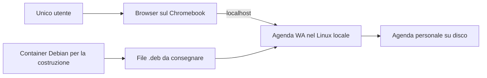

# Distribuzione locale di Agenda WA

Analisi del 13 ottobre 2026, avviata con le skill `grill-with-docs`, `grilling` e `domain-modeling`. I vincoli di destinazione sono stati confermati nel primo round e registrati nell’[ADR 0002](adr/0002-edizione-locale-personale.md). Il database e gli altri comportamenti ancora proposti non sono stati approvati o implementati.

## Obiettivo espresso

Distribuire Agenda WA per l’uso offline su un solo computer, mantenendo l’interfaccia nel browser. Il primo ambiente è un Chromebook con Linux già predisposto. La consegna consiste in un file `.deb`, fornito direttamente oppure scaricato da un link; l’applicazione deve funzionare anche quando il computer non ha accesso a Internet. È da valutare la sostituzione di MongoDB con un database relazionale incorporato, come H2.

Ogni destinatario usa soltanto la propria agenda locale, come unico utente, con una password di accesso. I dati non vengono condivisi né sincronizzati e non esiste uso della stessa agenda da più computer. Nel linguaggio dell’agenda, l’utente è il titolare e i clienti sono le persone o aziende cui si riferiscono appuntamenti e callback.

La predisposizione di Linux è un prerequisito già accettato; non è oggetto di ulteriore progettazione dell’installazione. L’abilitazione dell’ambiente Linux non richiede la modalità sviluppatore del dispositivo, come chiarisce la [FAQ ufficiale](https://chromeos.dev/en/linux/linux-on-chromeos-faq#do-i-need-to-enable-developer-mode).

## Situazione verificata nel repository

- L'app è già locale: un solo processo Java 21 / Spring Boot serve API, HTML, JavaScript, CSS e font. Il browser chiama le API sullo stesso indirizzo; non sono state trovate dipendenze Internet nel funzionamento ordinario. Riferimenti: [POM](../servizio/pom.xml), [client API](../servizio/src/main/resources/static/js/api.js), [architettura](ARCHITETTURA.md).
- Il server ascolta su `127.0.0.1`, porta predefinita 8080. MongoDB usa la porta locale 27018 e il replica set `rs0`. Le transazioni applicative dipendono da questo replica set. Riferimenti: [configurazione](../servizio/src/main/resources/application.properties), [transazioni](../servizio/src/main/java/xyz/nardone/agenda_wa/servizio/config/MongoConfiguration.java).
- L'avvio documentato richiede Java, MongoDB, inizializzazione del replica set e comandi manuali. Il risultato della compilazione è un JAR; non è configurato un installer con runtime incluso. Riferimento: [README](../README.md).
- Le credenziali sono locali. JWT, cookie HttpOnly, CSRF e isolamento tramite `ownerId` sono già implementati e restano requisiti del progetto anche nell'uso offline.
- La chiave JWT ha un percorso predefinito relativo alla directory di avvio. La distribuzione deve prevedere una destinazione stabile per dati e segreti, separata dai binari aggiornabili.
- Non sono state trovate funzioni per l'utilizzatore di backup, ripristino, recupero password o aggiornamento del prodotto. Le copie e le importazioni descritte nel README documentano interventi precedenti sul progetto.

## Vincoli verificati di Chromebook

Con Linux già predisposto, ChromeOS permette di installare pacchetti `.deb` dall’app File e avviare applicazioni dal menu. Il pacchetto deve essere utilizzabile su un computer privo di Internet: eventuali dipendenze native richieste devono essere già presenti nell’ambiente supportato oppure fornite nel pacchetto. Fonte: [configurazione Linux ChromeOS](https://chromeos.dev/en/linux/setup).

ChromeOS inoltra le connessioni a `localhost` verso il container Linux, con restrizioni sulle porte. La raggiungibilità effettiva con il binding del progetto e l'apertura del browser dal lanciatore devono essere provate sul dispositivo supportato. Fonte: [Chromium, inoltro localhost](https://www.chromium.org/chromium-os/developer-library/reference/security/port-forwarding/).

`jpackage` può produrre un installer Linux con runtime Java incluso, evitando un'installazione separata di Java. La costruzione avviene sulla piattaforma destinazione; il container ChromeOS mantiene l'architettura del dispositivo. I pacchetti e le verifiche devono quindi coprire le architetture che si sceglierà di supportare. Fonti: [documentazione jpackage](https://docs.oracle.com/en/java/javase/25/jpackage/packaging-overview.html), [FAQ ChromeOS](https://chromeos.dev/en/linux/linux-on-chromeos-faq).

L’utente riferisce un’esperienza precedente positiva con Java e H2, costruendo il pacchetto in un container Docker con una distribuzione Debian corrispondente a quella dell’ambiente Linux ChromeOS. Questa esperienza orienta la futura costruzione del `.deb`; versione Debian, runtime e architettura CPU devono comunque corrispondere ai dispositivi che si deciderà di supportare. Docker è uno strumento di costruzione sul computer dello sviluppatore: non è richiesto per eseguire l’applicazione sul computer del destinatario.

## Valutazione preliminare del database

H2 in modalità embedded con persistenza su disco lavora nello stesso processo Java e supporta transazioni e vincoli relazionali. Questo elimina la necessità di amministrare un processo MongoDB separato ed è una candidata per una singola installazione locale. La modalità in memoria non soddisfa il requisito di conservare i dati dopo l'arresto. Fonte: [H2, funzionalità](https://h2database.com/html/features.html).

La migrazione del progetto è sostanziale: coinvolge entità e indici MongoDB, repository, pipeline di aggregazione, ricerca testuale e comportamento degli accenti, storico incorporato nei clienti, copie delle generalità e dei cataloghi, transazioni e contatori di revisione. Si possono conservare i contratti HTTP e gran parte dell'interfaccia, ma la compatibilità deve essere verificata. Riferimenti: [architettura corrente](ARCHITETTURA.md), [query](../servizio/src/main/java/xyz/nardone/agenda_wa/servizio/repository/query/Queries.java), [repository dello storico](../servizio/src/main/java/xyz/nardone/agenda_wa/servizio/repository/ClientRepositoryCustomImpl.java).

H2 documenta backup coerenti e procedure di aggiornamento del motore tramite esportazione e importazione. Un semplice cambio di dipendenza Maven non rende il prodotto pronto per la produzione. Fonte: [H2, aggiornamenti e backup](https://h2database.com/html/tutorial.html#upgrade_backup_restore).

## Primo round: decisioni confermate

| Domanda | Risposta dell’utente |
| --- | --- |
| Q1 | Il destinatario può abilitare Linux; è già stata provata con successo un’applicazione Java/H2 costruita in Docker su Debian. |
| Q2 | Supporre un computer senza Internet. Il `.deb` viene fornito direttamente o scaricato prima; tutte le funzioni applicative sono locali. |
| Q3 | Un solo utente, una password, un solo computer, dati indipendenti senza condivisione o sincronizzazione. |
| Q4 | Consegnare il solo `.deb`; non concentrare il progetto sull’assistenza all’installazione. |

## Secondo round: decisioni aperte

| Domanda | Decisione richiesta | Raccomandazione |
| --- | --- | --- |
| Q5 | Confermare H2 incorporato con persistenza su disco come database dell’edizione locale. | H2, conservando contratti API e comportamenti verificati dell’agenda. |
| Q6 | Prevedere solo backup manuali oppure anche copie automatiche. | Copie locali automatiche e funzione di esportazione/ripristino per salvare una copia fuori dal computer. |
| Q7 | Definire cosa accade se l’utilizzatore dimentica la password. | Codice di recupero creato alla prima configurazione, da conservare separatamente; nessun recupero via email. |
| Q8 | Migrare anche i dati della copia attuale dello sviluppatore oppure iniziare con un’agenda vuota. | Migrare la sua agenda conservando MongoDB originale; nuove installazioni vuote con il solo catalogo iniziale. |

Dopo queste risposte restano da affrontare i rami dipendenti: schema e migrazione, sicurezza dei backup e del recupero, aggiornamenti con conservazione dei dati e rollback, avvio/arresto/sospensione, architetture e versioni supportate e criteri verificabili per il rilascio. Le scelte già confermate non vengono riproposte.

Le decisioni che comportano un costo significativo di revisione vengono registrate in `docs/adr/` quando concordate. `CONTEXT.md` resta il glossario del dominio e non contiene scelte tecniche di installazione o database.

## Versionamento

La versione web precedente alla trasformazione locale è salvata su GitHub in `main` e `codex/versione-online`, identificata dal tag `versione-online-2026-10-13`. Lo sviluppo locale avviene in `codex/versione-locale`. L’originale completo del commit locale `ca1e6a8`, che include materiale personale escluso dalla pubblicazione, resta nel branch locale `codex/archivio-originale` e non viene caricato sul repository pubblico.

I due commit remoti precedenti sul README restano nella cronologia della versione pubblicata. Non sono state modificate forzatamente le referenze remote, né pubblicati portafoglio, database, chiavi o le due schermate dei callback con anagrafiche reali. La cartella dati e gli eventuali database delle due edizioni devono restare distinti: il checkout Git non effettua migrazioni né ripristini dei dati.

## Vincoli del lavoro successivo

Seguire [AGENTS.md](../AGENTS.md): non aggiungere script personalizzati di avvio, arresto, migrazione o manutenzione; preservare i dati applicativi e dimostrativi dell'utente; usare ambienti di verifica isolati e completarne la pulizia. I dati dimostrativi personali presenti nel progetto non costituiscono dati iniziali da includere nell'installer destinato ad altre persone.

In questa analisi non sono stati avviati servizi, contattati o modificati database, né eseguite prove che producano dati di test.
